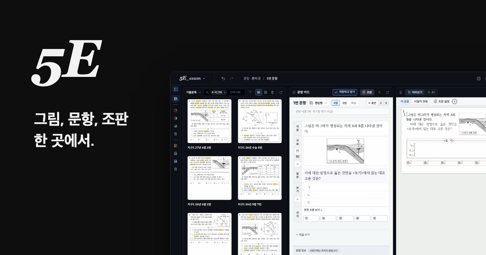
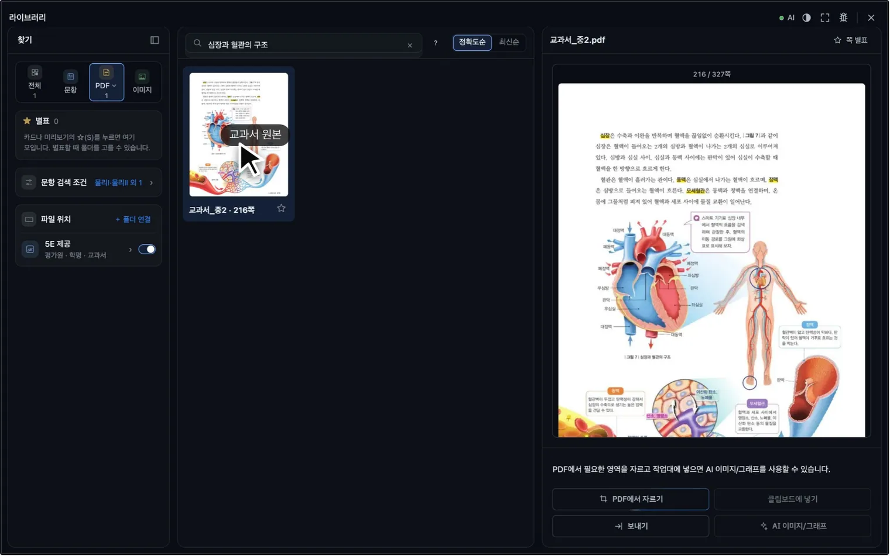
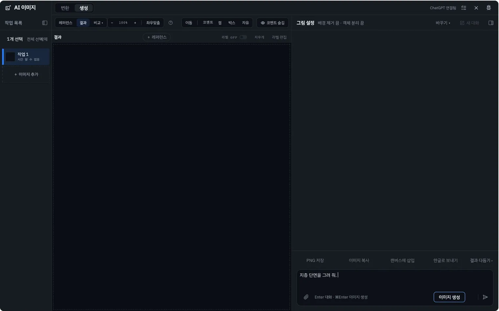
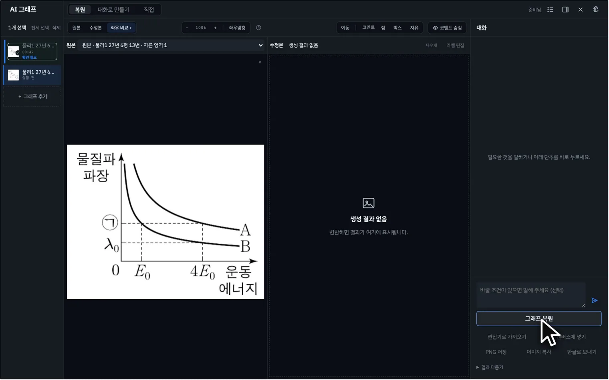
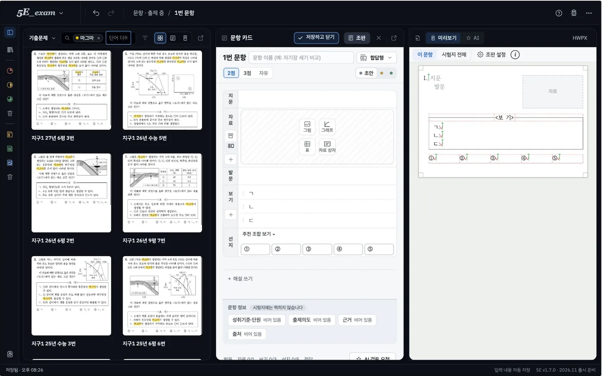
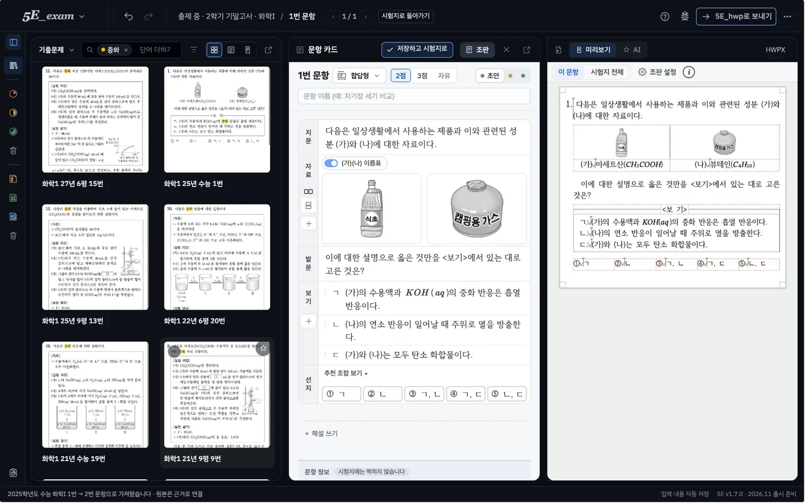
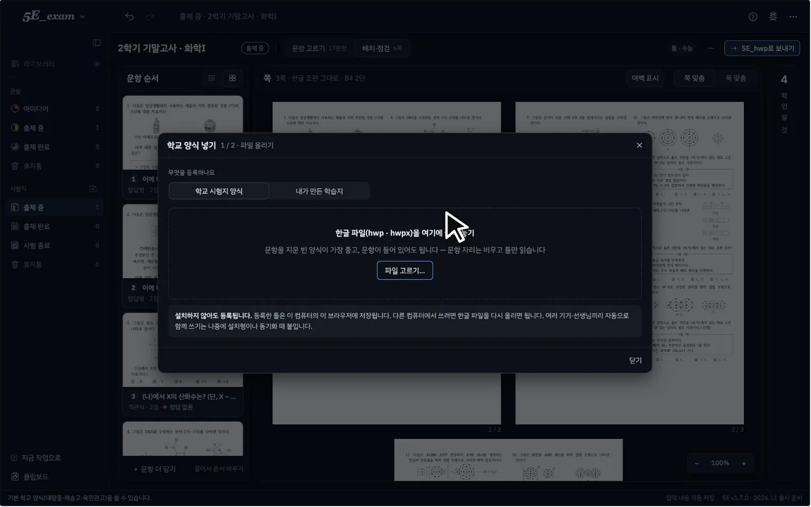
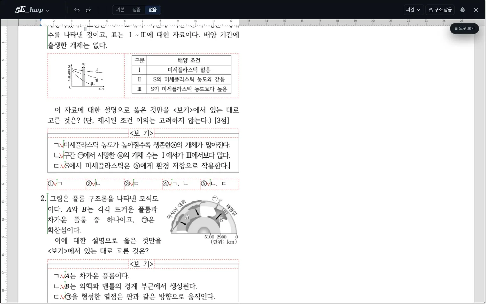
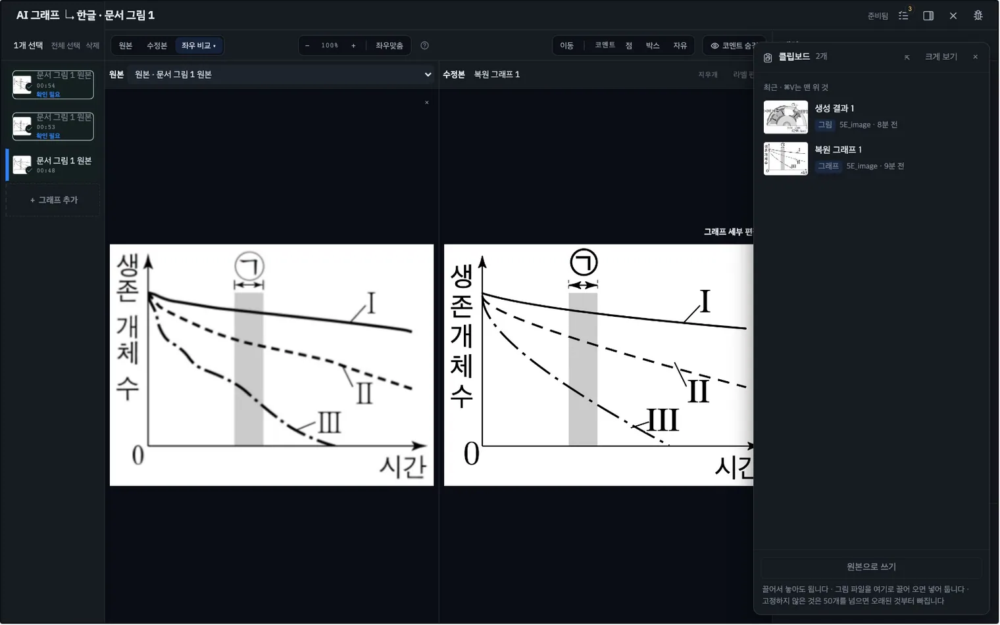

<p align="center">
  
</p>

<h1 align="center">5E</h1>

<p align="center">
  <b>과학 평가문항 제작 플랫폼</b><br>
  <sub><i>sciEnce Educational Evaluation Exam Editor</i></sub>
</p>

<h3 align="center">
  <a href="https://www.5e.ai.kr/">웹에서 바로 쓰기</a> &nbsp;·&nbsp;
  <a href="https://github.com/seungyeon980808-pixel/5E/releases/latest">내려받기</a> &nbsp;·&nbsp;
  <a href="https://www.5e.ai.kr/page/">둘러보기</a>
</h3>

<p align="center">
  <a href="https://www.5e.ai.kr/page/"></a>
</p>

<p align="center">
  
  
  
</p>

설치 없이 **www.5e.ai.kr** 을 열면 바로 씁니다. 한글(한컴오피스)이 없어도 HWP · HWPX를 열고 저장합니다.<br>
기출 변형 · 문항 쓰기 · 조판 · 저장은 AI 없이 됩니다. **이미지 변환 · 생성과 그래프 복원에는 GPT(ChatGPT 계정) 연결이 필요합니다.**

---

## 1분 시작

화면 왼쪽 위 로고(`5E_image` · `5E_exam` · `5E_hwp`)를 누르면 세 프로그램을 오갑니다. 단축키는 ⌥⌘1 · 2 · 3 (Windows Ctrl+Alt+1 · 2 · 3).

### 기출 문항을 변형해 시험지 만들기 — `5E_exam`

1. 왼쪽 메뉴에서 **새 문항 카드**를 엽니다.
2. 범위를 **기출문제**로 두고, 검색 칸에 낱말을 쓰고 Enter.
3. 마음에 드는 문항의 **변형** — 고칠 수 있는 내 문항 카드가 됩니다.
4. 왼쪽 메뉴 ＋(새 시험지) → **만들기** → 문항마다 **＋ 담기** → **다음: 배치 →**.
5. 조판이 저절로 끝납니다. ⋯ 메뉴 → **HWPX로 내려받기**.

<details>
<summary>학교 시험지 양식으로 뽑으려면</summary>

새 시험지 창에서 **내 틀**(한글 파일 올리기) → **학교 시험지 양식** → **파일 고르기…** → **확정하고 이 틀 쓰기**. 머리 표 · 꼬리말 · 단 · 쪽 번호는 그대로 두고 그 위에 문항을 조판합니다.
</details>

### 교과서 그림을 평가원 스타일로 — `5E_image`

1. 아래 줄 **라이브러리** → 왼쪽 **교과서**에서 낱말로 찾기.
2. **PDF에서 자르기**로 그림 영역을 끌어 잡기.
3. **AI 이미지/그래프** → **변환하기**.
4. **이미지 복사** — 5E 클립보드에도 담깁니다. `5E_exam`이나 `5E_hwp`에서 ⇧⌘V로 꺼내 넣으세요.

> 이미지 변환에는 GPT 연결이 필요합니다. 처음 한 번만 연결하면 됩니다 → [AI 연결하기](#ai-연결하기)

### 한글 시험지의 그림 고치기 — `5E_hwp`

1. **파일 → 한글 파일 열기…** (또는 HWP · HWPX 파일을 끌어다 놓기).
2. 고칠 그림을 두 번 누르면 그 자리에서 편집기가 열립니다 — 글자 고치기 · 자르기 · AI 변환.
3. **적용** → **파일 → 한글 저장 (.hwpx)**.

> 기출 PDF는 라이브러리에서 **보내기 → 한글 시험지로**를 누르면 고칠 수 있는 한글 파일로 열립니다.

---

## 왜 5E인가

학교 시험은 문제를 많이 만드는 일이 아니라, 성취기준 안에서 근거를 남기며 한 부를 바르게 만드는 일입니다.
5E는 그 과정 — 그림 준비, 문항 쓰기, 근거 연결, 시험지 배치, 한글 조판, 인쇄 전 점검 — 을 세 프로그램으로 나누어 한 흐름으로 잇습니다.

| 순서 | 하는 일 | 프로그램 |
|---|---|---|
| 1 · 찾기 | 평가원 · 학평 · 교과서 자료를 과목 · 단원 · 연도 · 낱말로. 정답 선지 형광펜, 별표로 모아 두기 | 라이브러리 |
| 2 · 그리기 | 필요한 그림을 잘라 시험용 선화로. 원본 글자는 고칠 수 있는 라벨로 제자리에 | `5E_image` |
| 3 · 쓰기 | 유형과 자료 구조를 고르면 평가원 문항 틀. 쓰는 대로 옆에 실제 한글 조판 | `5E_exam` |
| 4 · 묶기 | 학교 양식에 배치하고 순서 · 여백 · 배점 · 정답 분포 점검 | `5E_exam` |
| 5 · 인쇄 | 마지막 다듬기와 인쇄 전 점검, PDF · HWPX로 저장 | `5E_hwp` |

---

## 5E_image — 시험용 그림 · 그래프



- **AI 작업대** <sub>GPT 연결 필요</sub> — 이미지 변환 · 이미지 생성 · 그래프 복원 · 그래프 생성을 한 창에서. 여러 작업을 걸어 두면 끝날 때 알려 줍니다.
- **라벨 복원** — 원본 글자를 크기 · 위치 그대로 고칠 수 있는 라벨로. 물리량은 기울임, 숫자 · 단위는 바로 세웁니다.
- **부분 수정** — 고칠 곳에 점이나 영역 코멘트를 남기면 그 부분만 다시 그립니다.
- **캔버스** — 도형 · 글 · 수식 · 실험 장치 · 과학 오브젝트 · 에셋 라이브러리. PNG · SVG · `.5e`로 저장합니다.

**말로 그리기** <sub>1.7.2 · GPT 연결 필요</sub> — 그리고 싶은 그림을 말로 설명하면 평가원식 흑백 그림으로 그립니다. 마음에 안 드는 곳은 「여기 고쳐 줘」 한마디면 그 부분만 고칩니다. 물리부터 윤리까지.





- **그래프** — 사진 속 그래프를 눈금 · 글자 크기까지 재어 다시 그립니다. 숫자 하나 바꾸면 곡선이 따라오고, 축 이름 · 눈금은 그래프 위에서 바로 고칩니다.

## 5E_exam — 문항 · 시험지



- **문항 카드** — 지문 · 자료 · 발문 · 〈보기〉 · 선지를 시험지 순서대로. 〈보기〉는 ○ · ×만 누르면 정답이 정해지고, 표는 한글처럼(F5 · M · S), 수식은 글 속에서(⌘E).
- **실시간 조판** — 카드 옆 미리보기가 실제 HWP 조판입니다. 기본 틀은 수능 B4 원본 지면(단 폭 112mm · 11.5pt).



- **기출 변형** — 낱말로 찾고 「변형」. AI 없이 원본 PDF를 편집할 수 있는 한글 문항으로 바꿉니다. 1,440문항 시험에서 95.7%가 제자리에 복원됩니다.



- **학교 양식** — 학교 시험지 한글 파일을 올리면 머리 표 · 꼬리말 · 쪽 번호를 그대로 두고 그 위에 조판합니다.
- **시험지** — 담기 → 배치 → 여백 · 순서 → 점검 → 이원목적분류표 · B형 · 인쇄 · HWPX.
- **시험지 파일** — 문항 · 그림 · 양식 · 조판 기준을 `.5e` 하나에(⌘S 저장 · ⌘O 불러오기). 시험이 끝난 시험지는 잠가 둡니다.

## 5E_hwp — 조판 · 인쇄



- **한글 없이 한글 파일** — HWP · HWPX를 열고, 고치고, 저장합니다. 내보낸 HWPX는 한컴 한글에서 그대로 열립니다.
- **그 자리 편집** — 시험지 위 그림을 두 번 누르면 바로 편집기 — 글자 고치기 · 자르기 · AI 변환.
- **시험지 도구** — 시험지 머리 · 문항 간격 · 단 채우기 · 1단 · 2단 · 용지 · 쪽 번호 · 〈보기〉 · ㄱㄴㄷ 선지 · 번호 다시 · 고른 문항만 새 파일로.
- **인쇄 전 점검** — 넓은 그림, 번호 빠짐, 글꼴 섞임, 숫자 · 단위 띄어쓰기를 찾아 한 번에 고칩니다.
- 한컴 한글과 같은 단축키. [전체 목록](docs/HWP_EXAM_SHORTCUTS.md)

## 5E 클립보드 — 세 프로그램을 잇는 서랍



그림도, 그래프도, 문항도. ⌘C / Ctrl+C로 담아 두면 세 프로그램 어디서든 ⇧⌘V / Ctrl+Shift+V로 꺼내 씁니다.

움직이는 장면을 직접 눌러 보려면 → [둘러보기 페이지](https://www.5e.ai.kr/page/)

---

## 내려받기

| | 파일 |
|---|---|
| **웹** | <https://www.5e.ai.kr/> — 설치 없이, 열 때마다 최신판 |
| Mac · Apple 칩 | `5E-1.7.1-macos-arm64.dmg` |
| Mac · 인텔 | `5E-1.7.1-macos-x64.dmg` |
| Windows | `5E-1.7.1-windows-x64.exe` |

[최신 릴리스](https://github.com/seungyeon980808-pixel/5E/releases/latest)에서 받습니다. 사과 메뉴 › 「이 Mac에 관하여」에 「칩」이 보이면 Apple 칩, 「프로세서」가 보이면 인텔입니다.

> 설치 파일에는 아직 코드 서명이 없습니다. Windows에서 「PC 보호」 창이 뜨면 **추가 정보 → 실행**, Mac에서 처음 열 때 막히면 **시스템 설정 → 개인정보 보호 및 보안 → 그래도 열기**를 누르세요.<br>
> 1.7.0 이전 설치판의 최신 릴리즈 <strong>v1.5.8</strong>은 [v1.5.8 릴리즈 페이지](https://github.com/seungyeon980808-pixel/5E/releases/tag/v1.5.8)에 남아 있습니다.

<details>
<summary><b>웹과 설치판은 무엇이 다른가요?</b></summary>

| | 웹 | 설치판 |
|---|---|---|
| 시작 | www.5e.ai.kr 열기 | 내려받아 설치 |
| 세 프로그램 · 한글 파일 | 같음 | 같음 |
| 저장 | 「저장(.5e)」 → 내려받기 | 처음 저장할 때 이름 · 자리 고름 |
| 자동 저장 · 백업 | 브라우저 안 보관함 | + `~/Documents/5E/출제` 자동 저장 · 10분마다 백업 |
| `.5e` 두 번 눌러 열기 | — | 됨 |
| 새 버전 | 열 때마다 최신 | 시작 창에 알림 → 직접 받아 설치 |

웹과 설치판, 브라우저마다 저장 공간이 다릅니다. 옮길 때는 `.5e` 파일을 쓰세요.
</details>

## AI 연결하기

**이미지 변환 · 이미지 생성 · 그래프 복원**에는 GPT 연결이 필요합니다. ChatGPT 계정으로 로그인하며, 5E는 비밀번호를 받지 않습니다. 기출 변형 · 문항 쓰기 · 조판 · 인쇄 전 점검은 연결 없이 됩니다.

- **웹** — 위쪽 **AI** 표시 → **ChatGPT로 로그인** → **인증 코드 복사** → **OpenAI 인증하기 →** 에서 코드를 붙여 넣기.
- **설치판** — 내 컴퓨터에 로그인된 Codex를 씁니다. AI 이미지 칸 → **연결 정보** → **Codex 로그인**.

---

<details>
<summary><b>단축키</b></summary>

| | Mac | Windows |
|---|---|---|
| 프로그램 전환 | ⌥⌘1 · 2 · 3 | Ctrl+Alt+1 · 2 · 3 |
| 5E 클립보드 | ⇧⌘V | Ctrl+Shift+V |
| 기능 검색 | ⌘K | Ctrl+K |
| 글 속 수식 | ⌘E | Ctrl+E |
| 새로 조판 · 저장하고 시험지로 | ⌘Enter | Ctrl+Enter |
| 되돌리기 · 다시 하기 | ⌘Z · ⇧⌘Z | Ctrl+Z · Ctrl+Shift+Z |

단추에 마우스를 올리면 그 기능의 단축키가 보입니다. 5E_hwp는 한컴 한글과 같은 단축키를 씁니다. [전체 목록](docs/HWP_EXAM_SHORTCUTS.md)
</details>

<details>
<summary><b>내 자료는 어디에 저장되나요?</b></summary>

| | 저장되는 곳 | 밖으로 |
|---|---|---|
| 그림 · 문항 · 시험지 | 브라우저 저장소 (설치판은 `~/Documents/5E/출제`에도) | 나가지 않음 |
| 프로젝트 · 시험지 파일 | 내가 저장한 `.5e` | 직접 옮길 때만 |
| AI 작업 | 브라우저 저장소 | 실행할 때 원본과 요청만 AI 연결 서버로 |
| 웹 AI 로그인 | 탭의 sessionStorage에 5E 세션 토큰 하나 | 30분 쓰지 않으면 끝 |
</details>

<details>
<summary><b>자주 묻는 질문</b></summary>

**한글(한컴오피스)이 없어도 되나요?** — 됩니다. 내보낸 HWPX는 한컴 한글에서도 그대로 열립니다.

**기출 변형 결과는 원본과 같나요?** — 평가원 PDF를 AI 없이 한글 문항으로 바꿉니다. 1,440문항 시험에서 95.7%가 제자리에 복원됐습니다. 시험지에 넣기 전에 원본과 나란히 확인하세요.

**A4로 인쇄해도 되나요?** — 시험지는 수능 형태(B4 2단)가 기준입니다. A4로 뽑으면 쪽 전체가 약 82%로 줄어 그대로 들어갑니다.

**교과서 · 기출 그림을 써도 되나요?** — 각 저작권자의 이용 조건을 따릅니다. 라이브러리에 보인다는 것이 이용 권리를 확인했다는 뜻은 아닙니다.

더 많은 질문은 [둘러보기 페이지의 FAQ](https://www.5e.ai.kr/page/#faq)에서 찾을 수 있습니다.
</details>

---

**문제 신고** — [문제 신고 게시판](https://www.5e.ai.kr/bug/) 또는 [GitHub Issues](https://github.com/seungyeon980808-pixel/5E/issues). 웹/설치판, 브라우저, 무엇을 어떤 순서로 했는지 적어 주시면 빨리 고칩니다.

**문서** — [1.7.1 변경 내용](docs/RELEASE_NOTES_v1.7.1.md) · [1.7.0 변경 내용](docs/RELEASE_NOTES_v1.7.0.md) · [5E_hwp 단축키](docs/HWP_EXAM_SHORTCUTS.md) · [1.6.3 → 1.7.0 자료 호환](docs/DATA_COMPAT_1_6_3_TO_1_7_0.md) · [릴리스 이력](https://github.com/seungyeon980808-pixel/5E/releases)

<details>
<summary><b>개발</b></summary>

```bash
npm ci
npm run exam        # 로컬 서버로 열기
npm run desktop     # 설치판(Electron)으로 열기
npm test            # 단위 검사
```

Node 24.21 · Electron 44.4.5 · 한글 조판 엔진 rhwp. 디자인 규칙은 [DESIGN.md](DESIGN.md), 개발 기록은 [docs/dev/](docs/dev/README.md), 둘러보기 페이지 원본은 [page-src/](https://github.com/seungyeon980808-pixel/5E/tree/main/page-src)에 있습니다.
</details>

5E는 [GNU AGPL v3](LICENSE)로 배포됩니다.

<p align="center"><sub>게으른 교사가 만들었습니다 · 개발 박승연 (SMOE) · © 2026</sub></p>
